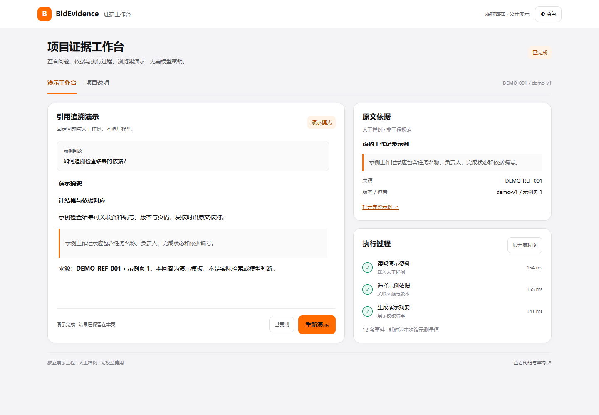

# BidEvidence Agent

**施工组织设计证据审查平台的独立展示工程**

[在线交互演示](https://umio5sigtuna.github.io/bid-evidence-agent-showcase/) · [自动化验证](https://github.com/Umio5sigtuna/bid-evidence-agent-showcase/actions/workflows/verify.yml) · [架构说明](docs/ARCHITECTURE.md)

面向 Agent / 大模型应用 / Python 后端岗位的作品展示。你可以直接运行界面，观察工具节点、流式文本、依据卡片与执行时间线；全部示例数据为人工编写，无需模型密钥。



## 项目背景

公共资源交易领域正在引入 AI 辅助评审。对于投标文件编制和内部审核，困难往往在于：项目要求分散在招标文件、答疑、清单图纸与技术规范中，正文、资源配置、进度和图表需要相互一致；发现问题后，还需要说清依据在哪里、适用什么条件、修改后如何回查。

完整版系统围绕“资料解析 → 要求拆解 → 依据检索 → 质量核查 → 人工复核 → 修订回查”组织证据工作流。青天大模型的公开材料属于行业背景研究；本项目为独立作品展示，不代表政府或科大讯飞官方项目、合作或授权。

## 这个仓库能看到什么

- **可运行的交互演示**：React + TypeScript + React Flow 展示三个有界工具节点、Markdown 流式文本、引用卡片与执行事件。
- **两种运行方式**：默认浏览器离线模拟；可选 FastAPI / asyncio 后端以真实 HTTP / SSE 传递预置事件。
- **可以阅读的工程代码**：类型化消息、来源身份校验、事件顺序与重复保护、请求幂等、并发容量控制及请求取消。
- **设计说明与自动化检查**：架构文档、公开范围说明、前后端测试与 GitHub Actions 定义。

界面采用统一的浅色 / 深色主题和紧凑工作区；操作区首屏可见，流程图按需加载。演示支持停止、重新执行及复制结果，切换到项目说明后保留本次状态。

演示问题、文本和工具清单只在 `demo/scenario.json` 维护，前后端共同读取；`scripts/sync-demo.mjs` 在构建时生成可查看的示例文本。

演示回答由模板生成，三个工具也只处理人工样例。**本仓库不运行真实检索、LLM、评分或标书质量判断。**

## 完整版技术选型与公开范围

| 层次       | 完整版采用的技术                              | 本仓库的公开内容                                 |
| ---------- | --------------------------------------------- | ------------------------------------------------ |
| Agent 执行 | LangChain、LangGraph、工具调用与受控复核      | 三个演示动作、工具状态和有序事件；核心实现不公开 |
| 检索与来源 | LlamaIndex、BGE、混合检索、本地重排、原文追溯 | 人工编写的示例引用、版本与来源卡片               |
| 服务与调度 | FastAPI、asyncio、持久任务、幂等、租约        | 独立编写的内存演示队列、幂等与 SSE 接口          |
| 交互       | React / TypeScript、React Flow、流式对话      | 可运行的独立界面及响应式布局                     |
| 观测与权限 | OpenTelemetry、JWT / RBAC、项目隔离           | 演示事件时间线和身份校验；生产鉴权实现不公开     |
| 互通       | 只读 MCP 工具接口                             | 架构职责说明；内部服务地址与配置不公开           |

表中“完整版”描述技术选型，不表示本仓库包含其完整实现。演示时间线是事件记录，不是 OpenTelemetry SDK 的实现展示。

## 快速开始

运行环境：Node.js 24（或满足 Vite 要求的兼容版本），可选 Python 3.12。

```bash
npm ci
npm run dev
```

打开 `http://127.0.0.1:5174`，点击“执行演示”。默认不发送网络模型请求，也不需要后端或 API Key。

### 可选真实 HTTP 与 SSE

```bash
python -m venv .venv
# 激活虚拟环境后
python -m pip install -r requirements.txt
python -m uvicorn backend.app:app --host 127.0.0.1 --port 8093 --timeout-graceful-shutdown 5
```

再开一个终端指定本机演示后端：

```powershell
# PowerShell
$env:VITE_DEMO_API_BASE = 'http://127.0.0.1:8093'
npm run dev
```

```bash
# bash / zsh
VITE_DEMO_API_BASE=http://127.0.0.1:8093 npm run dev
```

这仍是虚构样例：后端仅把预置文本拆成 SSE 消息，不调用模型，不读取真实文件；队列在进程退出后清空，不能作为生产持久队列使用。

## 验证与构建

```bash
npm test
npm run build
python -m unittest discover -s tests -v
```

测试关注跨项目 / 任务身份、重复和乱序事件、终态保护、幂等冲突、SSE 游标恢复及接口边界。仓库的 CI 只验证公开演示，不运行内部系统。

## 可以重点讨论的工程问题

1. 为什么将检索候选、采用依据、问题判断和人工复核分开？
2. SSE 重连或提交回执丢失时，如何避免重复任务与状态回退？
3. 工具调用怎样限制到已登记能力，避免文档内容被当作执行指令？
4. 怎样把异步接口、阻塞检索和长任务分离，并保留结果不明的失败记录？
5. 交叉编码器重排为什么需要独立标注集验证，而不能只展示自评“准确率”？

架构和边界见 [设计说明](docs/ARCHITECTURE.md)、[公开范围](docs/PUBLIC_SCOPE.md)。

## 未公开内容

真实标书、客户 / 企业资料、图纸、规范全文、知识库和向量索引、核心规则与适用逻辑、评分权重、内部复核记录、原模型请求与返回、数据库、密钥、商业配置及原项目 Git 历史均未包含。

公开内容用于作品展示与技术交流，复用请联系仓库作者。
