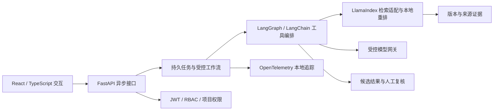
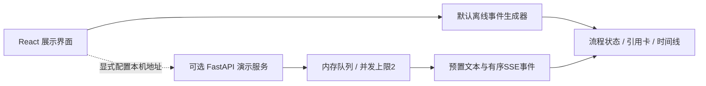

# 架构与实现范围

## 业务目标

为投标文件编制和内部审核建立可追溯的证据工作流：从项目资料中提取要求，以适用依据支持核查，再把候选问题交给人工确认，并能回查修改结果。没有读到、未命中、条件未知与确定不足需要分别保留。

## 完整版的职责划分

这是一张高层职责图。业务规则、评分参数、适用判断、具体提示词和真实数据结构不在公开范围。

## 展示仓库实际运行的部分

- 三个动作只有读取人工文本、选择预置引用、组合模板摘要，没有真实 Agent 规划或模型推理。
- `request_id` 对应语义摘要；相同 ID 与不同输入产生冲突，重复提交返回同一个演示任务。
- SSE 事件携带任务、项目和递增序号；服务端支持游标，客户端拒绝身份不符或跳号消息，忽略已处理事件。
- 后端最多保存64个任务、最多同时执行2个任务；过期已完成任务会清理，退出时取消未完成协程。
- 本仓库没有持久化、账户系统或生产鉴权，不与内部系统互联。

## 技术证据的口径

运行测试可以证明对应的接口和状态行为；不能证明工程专业判断正确、真实模型效果或生产并发性能。实际界面截图来自本仓库的虚构样例，不来自客户或内部系统。

完整版的真实模型效果需要独立数据与标注验证；OpenClaw / Hermes、Linux 容器部署等不能仅凭架构图宣称完成。本仓库的 GitHub Actions 验证公开演示，与完整版的部署验收相互独立。
